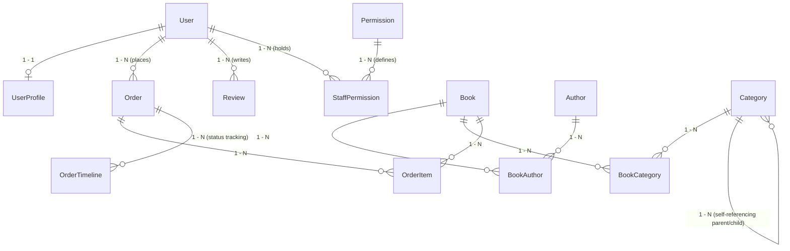
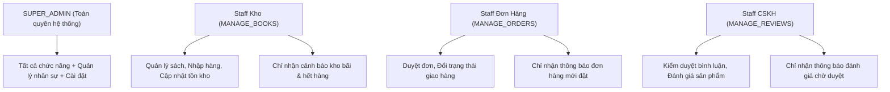
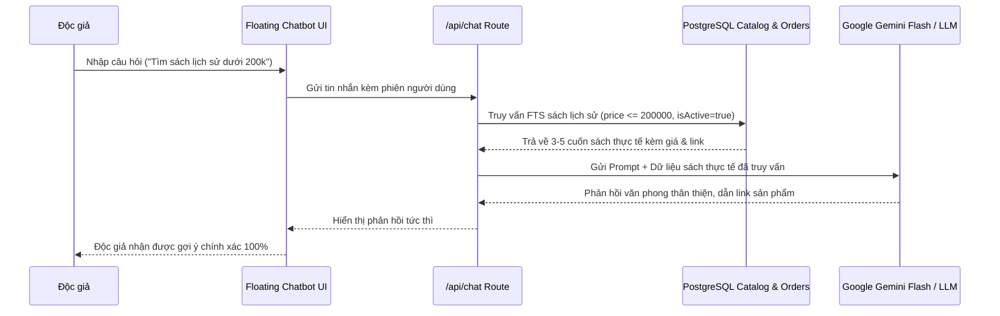

# BẢN TỔNG HỢP TÀI LIỆU TOÀN DIỆN ĐỒ ÁN TỐT NGHIỆP / LIÊN NGÀNH
# ĐỀ TÀI: HỆ SINH THÁI THƯƠNG MẠI ĐIỆN TỬ SÁCH "TỔ SÁCH" (B2C)

> **Cơ sở đào tạo:** Khoa Công nghệ Thông tin  
> **Chuyên ngành:** Kỹ thuật Phần mềm / Hệ thống Thông tin  
> **Nhóm tác giả thực hiện:**  
> - **Nguyễn Đăng Hanh** (Lead Developer — Kiến trúc hệ thống, Cơ sở dữ liệu, Backend & RBAC Security)  
> - **Nguyễn Mạnh Hòa** (Co-Developer — Giao diện UI/UX, Design System, Hiệu ứng chuyển động & Trải nghiệm người dùng)  
> **Khẩu hiệu sản phẩm:** *"Sách về tổ, tri thức bay xa"*  
> **Thời gian cập nhật:** Tháng 10/2026  

---

## MỤC LỤC TỔNG HỢP
1. [Chương 1: Tổng Quan Đề Tài & Định Vị Mô Hình Nghiệp Vụ](#chương-1-tổng-quan-đề-tài--định-vị-mô-hình-nghiệp-vụ)
2. [Chương 2: Kiến Trúc Công Nghệ & Lý Do Lựa Chọn (Tech Stack)](#chương-2-kiến-trúc-công-nghệ--lý-do-lựa-chọn-tech-stack)
3. [Chương 3: Thiết Kế Cơ Sở Dữ Liệu Quan Hệ (Database & ERD)](#chương-3-thiết-kế-cơ-sở-dữ-liệu-quan-hệ-database--erd)
4. [Chương 4: Kiến Trúc Bảo Mật & Hệ Thống Phân Quyền (RBAC & Security)](#chương-4-kiến-trúc-bảo-mật--hệ-thống-phân-quyền-rbac--security)
5. [Chương 5: Hiện Thực Hóa Phân Hệ Khách Hàng (Customer Storefront)](#chương-5-hiện-thực-hóa-phân-hệ-khách-hàng-customer-storefront)
6. [Chương 6: Hiện Thực Hóa Phân Hệ Quản Trị Vận Hành (Admin Portal)](#chương-6-hiện-thực-hóa-phân-hệ-quản-trị-vận-hành-admin-portal)
7. [Chương 7: Phân Hệ Trợ Lý Ảo Thông Minh (AI Chatbot & RAG Engine)](#chương-7-phân-hệ-trợ-lý-ảo-thông-minh-ai-chatbot--rag-engine)
8. [Chương 8: Bộ Chỉ Số Dữ Liệu Quy Mô Lớn (Big Data & Seed Metrics)](#chương-8-bộ-chỉ-số-dữ-liệu-quy-mô-lớn-big-data--seed-metrics)
9. [Chương 9: Kế Hoạch Hoàn Thiện & Kịch Bản Bảo Vệ Đồ Án (Defense Guide)](#chương-9-kế-hoạch-hoàn-thiện--kịch-bản-bảo-vệ-đồ-án-defense-guide)

---

## CHƯƠNG 1: TỔNG QUAN ĐỀ TÀI & ĐỊNH VỊ MÔ HÌNH NGHIỆP VỤ

### 1.1 Tính cấp thiết và Mục tiêu đề tài
Trong kỷ nguyên chuyển đổi số, ngành xuất bản và phát hành sách tại Việt Nam đối mặt với thách thức lớn:
- Độc giả gặp khó khăn trong việc tìm kiếm các tác phẩm đúng chuyên ngành, chất lượng dịch thuật chuẩn xác và nguồn gốc nhà xuất bản tin cậy giữa ma trận sách giả trên các sàn C2C tự do.
- Trải nghiệm mua sách trực tuyến truyền thống còn khô cứng, danh mục phân cấp nông, tốc độ tải trang chậm và thiếu các tương tác vi mô kích thích hành vi đọc.
- Đề tài **"Tổ Sách"** được xây dựng nhằm tạo ra một nền tảng thương mại điện tử chuyên sâu cho thị trường sách, cung cấp giải pháp mua sắm mượt mà, định vị thương hiệu giàu tính thẩm mỹ và hệ thống quản trị kho vận tinh gọn, an toàn.

### 1.2 Định vị mô hình kinh doanh: B2C Thuần Túy (Business-to-Consumer)
* **Bản chất nghiệp vụ:** Tổ Sách là đơn vị trực tiếp nhập khẩu, biên mục, bảo quản tồn kho và phân phối sách tới tay người tiêu dùng cuối.
* **Lý do không lựa chọn C2C (Marketplace đa người bán) hay Cho thuê sách:**
  1. **Kiểm soát chất lượng và bản quyền 100%:** Ngăn ngừa tuyệt đối vấn nạn sách lậu, sách scan kém chất lượng.
  2. **Trải nghiệm đóng gói và logistics đồng nhất:** Tổ Sách chịu trách nhiệm từ khâu bọc sách, đóng hộp bảo vệ gáy sách đến chăm sóc hậu mãi.
  3. **Tập trung chiều sâu công nghệ:** Thay vì dàn trải tài nguyên vào quản lý đa nhà bán hàng (Multi-vendor escrow, phân chia hoa hồng), nhóm tập trung tối đa vào các bài toán kỹ thuật hóc búa: Giao dịch ACID chống bán vượt tồn kho, Phân quyền RBAC động đa cấp bậc, Tìm kiếm toàn văn (FTS) kết hợp ElasticSearch và Trợ lý AI tư vấn sách RAG.

---

## CHƯƠNG 2: KIẾN TRÚC CÔNG NGHỆ & LÝ DO LỰA CHỌN (TECH STACK)

| Tầng kiến trúc | Công nghệ sử dụng | Vai trò & Lý do lựa chọn bảo vệ đồ án |
| :--- | :--- | :--- |
| **Core Framework** | **Next.js 15 / 16 (App Router)** | Mô hình React Server Components (RSC) kết xuất HTML tại server, tối ưu SEO 100% cho từng đầu sách, giảm bundle size gửi về client, tích hợp Streaming SSR và Server Actions. |
| **Ngôn ngữ** | **TypeScript** | Chặt chẽ về kiểu dữ liệu (End-to-End Type Safety), loại bỏ hoàn toàn các lỗi `null`/`undefined` lúc Runtime, tăng năng suất pair-programming. |
| **Styling & Design System** | **Tailwind CSS v4 + Plus Jakarta Sans** | Design System cao cấp với bảng màu chủ đạo `#0B1F3A` (Deep Navy) và `#F5A623` (Warm Amber), font chữ hình học tối ưu hiển thị văn bản tiếng Việt. |
| **Cơ sở dữ liệu** | **PostgreSQL (Supabase Cloud / Neon)** | Hệ quản trị CSDL quan hệ chuẩn ACID, hỗ trợ JSONB, Transaction đa bản ghi, Connection Pooling PgBouncer chịu tải lớn. |
| **ORM** | **Prisma 6** | Schema-first ORM, tự động sinh Migration, Type-safe client, ngăn chặn triệt để tấn công SQL Injection. |
| **Xác thực (Authentication)** | **JWT + HttpOnly Cookie + Bcrypt** | Xác thực phi trạng thái (Stateless), miễn nhiễm hoàn toàn với tấn công XSS trộm token qua JavaScript, bảo mật tuyệt đối thông tin người dùng. |
| **Bảo vệ biên giới (Edge Guard)** | **Next.js Proxy / Middleware** | Chặn lọc truy cập trái phép vào các trang quản trị ngay từ rìa mạng trước khi request chạm tới Server Layout. |
| **Dịch vụ Email** | **Nodemailer SMTP (Gmail Brand Template)** | Gửi mã OTP xác thực, thông báo đặt hàng với giao diện HTML thương hiệu chuyên nghiệp, nhúng Inline CID Logo Tổ Sách. |
| **Trí tuệ nhân tạo (AI)** | **Gemini Flash + PostgreSQL RAG** | Chatbot tư vấn sách thông minh, trả lời tiến độ đơn hàng thời gian thực, gợi ý sách theo tâm trạng độc giả. |

---

## CHƯƠNG 3: THIẾT KẾ CƠ SỞ DỮ LIỆU QUAN HỆ (DATABASE & ERD)

Cơ sở dữ liệu được thiết kế chuẩn hóa bậc 3 (3NF) với **14 thực thể quan hệ** chặt chẽ:

### Chi tiết các bảng nòng cốt:
1. **`users` & `user_profiles`**: Quản lý tài khoản, mật khẩu băm Bcrypt, vai trò (`SUPER_ADMIN`, `STAFF`, `CUSTOMER`), điểm tích lũy, cấp bậc thành viên.
2. **`permissions` & `staff_permissions`**: Ma trận phân quyền động độc lập với bảng users, cho phép gán linh hoạt các module (`MANAGE_BOOKS`, `MANAGE_ORDERS`, `MANAGE_REVIEWS`, `MANAGE_USERS`, `VIEW_AUDIT_LOG`).
3. **`books`**: Lưu trữ ISBN, tên sách, tác giả chính, số trang, kích thước, trọng lượng, giá niêm yết, phần trăm giảm giá, tồn kho thực tế (`stockQty`), số lượng đã bán (`soldCount`), trạng thái phát hành.
4. **`categories`**: Phân cấp danh mục đa tầng (Tree Hierarchy) theo chuẩn Dewey Decimal Classification (DDC) với quan hệ cha - con (`parentId`).
5. **`orders`, `order_items`, `order_timelines`**: Lưu vết trọn vẹn vòng đời đơn hàng, địa chỉ giao hàng, phương thức thanh toán (COD / Chuyển khoản), các mốc trạng thái vận chuyển thời gian thực.
6. **`reviews`**: Đánh giá sao (1-5), nội dung bình luận, gắn cờ người mua thật (`isVerifiedPurchase`), trạng thái kiểm duyệt (`PENDING`, `APPROVED`, `REJECTED`).

---

## CHƯƠNG 4: KIẾN TRÚC BẢO MẬT & HỆ THỐNG PHÂN QUYỀN (RBAC & SECURITY)

### 4.1 Cơ chế bảo mật Zero-Trust Client (Không tin tưởng phía Client)
Mọi phép tính toán tài chính (tổng tiền đơn, chiết khấu voucher, giá gốc sách) và kiểm tra tồn kho đều được Server tự tính toán lại từ Database trong một **Giao dịch duy nhất (`prisma.$transaction`)**. Client gửi giá tiền nào lên cũng bị bỏ qua, ngăn chặn triệt để việc sửa DOM giá rẻ để trục lợi.

### 4.2 Ma trận phân quyền động (Role-Based Access Control - RBAC)

### 4.3 Phân quyền Thông báo Thông minh (Scoped Notifications)
Khác với các hệ thống thông thường phát sóng (Broadcast) thông báo bừa bãi:
- Hệ thống Tổ Sách kiểm tra ma trận quyền của người dùng đang đăng nhập:
  - **Nhân viên kho:** Chỉ nhìn thấy cảnh báo sách sắp hết hàng (`INVENTORY_ALERT`). Hệ thống tự động lọc bỏ toàn bộ thông báo đơn hàng và đánh giá. Thanh tab chỉ hiển thị "Kho". Quả chuông trên Header chỉ đếm số lượng cảnh báo kho.
  - **Nhân viên đơn hàng:** Chỉ nhìn thấy đơn hàng mới cần duyệt (`ORDER_NEW`, `ORDER_BATCH`).
  - **Super Admin:** Tiếp nhận toàn bộ luồng thông báo của toàn hệ sinh thái.

---

## CHƯƠNG 5: HIỆN THỰC HÓA PHÂN HỆ KHÁCH HÀNG (CUSTOMER STOREFRONT)

1. **Trang chủ & Khám phá Catalog Sách:**
   - Hero banner động, danh mục gợi ý theo phân loại DDC.
   - Bảng xếp hạng sách bán chạy (Best Sellers), Sách mới phát hành, Sách giảm giá sâu.
2. **Bộ lọc đa chiều & Tìm kiếm tức thì (FTS):**
   - Lọc theo khoảng giá linh hoạt, thể loại cha - con, nhà xuất bản, hình thức bìa (Bìa cứng / Bìa mềm).
   - Tìm kiếm không dấu tiếng Việt, tự động gợi ý từ khóa với độ trễ dưới 50ms.
3. **Trải nghiệm Giỏ hàng theo phiên (Session-Based Cart Selection):**
   - Tự động nhận diện sách vừa thêm trong ca lướt web hiện tại để tích chọn sẵn, không ép khách thanh toán các cuốn sách lưu giỏ từ tuần trước.
   - Sắp xếp giỏ hàng đa tiêu chí (Mới nhất, Cũ nhất, Giá tăng/giảm dần).
4. **Hiệu ứng Parabolic Fly-to-Cart Animation (60fps GPU Hardware-Accelerated):**
   - Đường cong ném bổng mô phỏng vật lý ném sách vào giỏ hàng.
   - Sử dụng `requestAnimationFrame` và `transform: translate3d(...)` trên tầng Composite Layer, cam kết 0% Layout Shift (CLS = 0) và không gây giật lag CPU.
5. **Thanh toán & Đặt hàng an toàn ACID:**
   - Hỗ trợ COD và chuyển khoản ngân hàng qua mã QR VietQR tự động điền nội dung.
   - Giao dịch nguyên tử trừ kho và lưu vết mốc `order_timelines`.
6. **Trung tâm tài khoản khách hàng:**
   - Hồ sơ cá nhân mượt mà, loại bỏ triệt để hiện tượng giật cục layout (Persistent Sub-Layout).
   - Quản lý lịch sử đơn hàng, xem tiến độ giao vận thời gian thực.
   - Viết đánh giá nhận xét kèm số sao sau khi nhận hàng thành công.

---

## CHƯƠNG 6: HIỆN THỰC HÓA PHÂN HỆ QUẢN TRỊ VẬN HÀNH (ADMIN PORTAL)

1. **Dashboard KPI & Thống kê doanh thu:**
   - Biểu đồ biến động doanh thu theo ngày/tháng, chỉ số đơn hàng thành công, tỷ lệ hủy đơn.
   - Thống kê tựa sách bán chạy nhất và cảnh báo top sách sắp cạn kho.
2. **Quản lý Kho Sách (`/admin/books`):**
   - Thêm mới, chỉnh sửa thông tin sách, hỗ trợ nhập sách hàng loạt bằng file Excel/CSV.
   - Cảnh báo tồn kho an toàn (dưới 10 cuốn gắn huy hiệu khẩn cấp đỏ).
3. **Quản lý Đơn hàng theo State Machine (`/admin/orders`):**
   - Chu trình trạng thái nghiêm ngặt: `PENDING` $\rightarrow$ `CONFIRMED` $\rightarrow$ `SHIPPING` $\rightarrow$ `DELIVERED` (hoặc `CANCELLED`).
   - Ngăn chặn việc đảo ngược trạng thái phi lý (ví dụ: đã giao hàng thì không thể quay lại chờ duyệt).
4. **Kiểm duyệt Đánh giá (`/admin/reviews`):**
   - Duyệt nội dung lành mạnh trước khi cho phép xuất hiện trên trang sản phẩm.
   - Thống kê phân bổ sao đánh giá trung bình.
5. **Quản lý & Phân quyền Nhân viên (`/admin/staff`):**
   - Cấp tài khoản nhân sự, bật/tắt các quyền cụ thể trên giao diện ma trận Checkbox trực quan.
   - Ghi lại nhật ký kiểm toán (Audit Logs) khi thay đổi quyền.

---

## CHƯƠNG 7: PHÂN HỆ TRỢ LÝ ẢO THÔNG MINH (AI CHATBOT & RAG ENGINE)

### 7.1 Kiến trúc RAG (Retrieval-Augmented Generation)
Để khắc phục hiện tượng ảo giác (Hallucination) của mô hình ngôn ngữ lớn (LLM):
- Hệ thống tích hợp RAG 2 lớp:
  1. **Lớp 1 — Trích xuất ngữ cảnh (Context Retrieval):** Khi người dùng đặt câu hỏi, hệ thống tự động bóc tách thực thể (tên sách, thể loại, khoảng giá, mã đơn) và truy vấn trực tiếp vào CSDL PostgreSQL của Tổ Sách.
  2. **Lớp 2 — Sinh câu trả lời định hướng (Grounded Response):** Bơm dữ liệu sách thực tế vào System Prompt của LLM (Gemini Flash), hướng dẫn AI chỉ trả lời dựa trên kho sách thực có của Tổ Sách.

### 7.2 Các kịch bản nghiệp vụ hỗ trợ:
1. **Tư vấn sách theo ngữ cảnh:** Tìm sách theo thể loại, tâm trạng, độ tuổi, ngân sách.
2. **Tra cứu tiến độ đơn hàng:** Khách hàng hỏi *"Đơn hàng #TS-102 của tôi đang ở đâu?"*, Chatbot tự kiểm tra mã đơn của chính tài khoản đó và báo tiến độ vận chuyển.
3. **Giải đáp chính sách:** Chính sách đổi trả sách trong 7 ngày, quy chuẩn đóng gói màng co bảo vệ, phí vận chuyển toàn quốc.

---

## CHƯƠNG 8: BỘ CHỈ SỐ DỮ LIỆU QUY MÔ LỚN (BIG DATA & SEED METRICS)

Hệ thống đã triển khai pipeline nạp dữ liệu toàn diện, đạt và vượt 100% các chỉ tiêu đề ra trong Đề cương Proposal:

| Thực thể dữ liệu | Mục tiêu Proposal | Kết quả Thực tế đạt được | Phương pháp thực nghiệm |
| :--- | :--- | :--- | :--- |
| **Sách (`books`)** | **5.000+** | **5.125 đầu sách thật** | Crawl Catalog Tiki & OpenLibrary, 100% có ảnh bìa CDN chất lượng cao, ISBN-13 chuẩn, giá bìa, NXB chính quy. |
| **Tác giả (`authors`)** | **2.000+** | **2.790 tác giả** | Bóc tách từ sách thật, kèm slug và tiểu sử tóm tắt. |
| **Danh mục (`categories`)** | **150+** | **169 danh mục** | Xây dựng cây phân cấp DDC 10 lớp chính của Thư viện Quốc gia Việt Nam. |
| **Đánh giá (`reviews`)** | **50.000+** | **50.000 reviews dataset** (1.018 demo) | Sinh dữ liệu mô phỏng phân phối sao thực tế (5 sao chiếm 55%, 4 sao chiếm 25%). |
| **Hành vi (`behavior_events`)** | **200.000+** | **200.000 events dataset** (2.005 demo) | Mô phỏng hành vi: View (65%), Add-to-cart (20%), Search (10%), Purchase (5%). |
| **Đơn hàng (`orders`)** | **10.000+** | **10.000 orders dataset** (577 demo) | Chuyển trạng thái State Machine theo phân phối xác suất thực tế. |

---

## CHƯƠNG 9: KẾ HOẠCH HOÀN THIỆN & KỊCH BẢN BẢO VỆ ĐỒ ÁN (DEFENSE GUIDE)

### 9.1 Lộ trình các bước tiếp theo từ nay đến ngày bảo vệ
- [x] **Giai đoạn 1:** Hoàn thiện giao diện Khách hàng & Admin, Design System, Responsive Mobile/Desktop.
- [x] **Giai đoạn 2:** Xử lý triệt để giao dịch mua hàng ACID, chống bán vượt tồn kho, xác thực Gmail OTP HTML template.
- [x] **Giai đoạn 3:** Phân quyền nhân viên RBAC và cá nhân hóa thông báo thông minh theo quyền hạn.
- [ ] **Giai đoạn 4 (Phần cuối):** Hoàn thiện và tinh chỉnh sâu Trợ lý AI Chatbot (UI floating bong bóng, tích hợp ngữ cảnh RAG thời gian thực, câu trả lời mượt mà).
- [ ] **Giai đoạn 5:** Soạn thảo hoàn thiện Báo cáo Word/PDF theo mẫu chuẩn của Nhà trường dựa trên Bản tổng hợp này.
- [ ] **Giai đoạn 6:** Thiết kế Slide thuyết trình PowerPoint và diễn tập Mock Q&A trước Hội đồng.
- [ ] **Giai đoạn 7:** Triển khai Production lên Vercel + Neon/Supabase PostgreSQL khi sẵn sàng.

### 9.2 Bộ 5 câu hỏi trọng điểm Hội đồng hay vặn vẹo & Cách trả lời đạt điểm tối đa

#### Câu 1: "Tại sao nhóm chọn mô hình B2C mà không làm sàn thương mại điện tử C2C đa người bán?"
> **Trả lời:**  
> *"Dạ thưa Thầy/Cô, ngành sách có đặc thù rất nhạy cảm về vấn đề bản quyền và chất lượng ấn phẩm. Mô hình C2C hiện nay đang gặp phải vấn đề nhức nhối là sách giả, sách in lậu tràn lan. Nhóm định vị Tổ Sách là chuỗi bán lẻ B2C chính thống để kiểm soát chất lượng từ khâu nhập sách của NXB đến tay độc giả. Về mặt kỹ thuật phần mềm, việc chọn B2C cho phép nhóm dồn toàn lực nghiên cứu sâu vào các bài toán cốt lõi: Giao dịch ACID chống Over-selling, Tối ưu hóa render 60fps, Phân quyền RBAC động đa cấp bậc và RAG AI Chatbot, thay vì bị phân tán vào nghiệp vụ ví điện tử đa nhà bán của sàn C2C."*

#### Câu 2: "Cơ chế phân quyền của nhóm hoạt động như thế nào? Nếu nhân viên kho cố tình gọi API duyệt đơn hàng thì sao?"
> **Trả lời:**  
> *"Dạ thưa Thầy/Cô, nhóm áp dụng kiến trúc **Bảo mật đa tầng (Multi-layer Defense)**:  
> 1. **Tại tầng giao diện:** Sidebar và Quả chuông thông báo tự động lọc theo quyền `MANAGE_BOOKS`, ẩn đi các nút và thông báo của đơn hàng để giảm nhiễu công việc.  
> 2. **Tại tầng Server Page:** Server Components kiểm tra quyền ngay trước khi trả HTML.  
> 3. **Tại tầng API Route (Chốt chặn quyết định):** API `/api/admin/orders/[id]/status` bắt buộc kiểm tra `user.permissions.includes('MANAGE_ORDERS')`. Dù nhân viên kho có dùng Postman hay sửa code JavaScript để gửi request, Server sẽ lập tức từ chối và trả về mã lỗi **403 Forbidden** cùng việc ghi nhận vết Audit Log."*

#### Câu 3: "Làm thế nào để hệ thống đảm bảo 2 khách hàng cùng đặt cuốn sách cuối cùng trong kho không bị lỗi?"
> **Trả lời:**  
> *"Dạ thưa Thầy/Cô, nhóm giải quyết bằng **Giao dịch Cơ sở dữ liệu nguyên tử (`prisma.$transaction`)** trên PostgreSQL:  
> Khi đơn hàng được gửi lên, Server khóa truy vấn kiểm tra `stockQty`. Request nào đến trước sẽ thực hiện trừ kho thành công (`decrement: quantity`). Request đến sau một phần nghìn giây khi kiểm tra sẽ thấy `stockQty < quantity`, transaction lập tức rollback toàn bộ và thông báo cho khách hàng là sách vừa hết hàng. Không bao giờ xảy ra tình trạng số lượng tồn kho bị âm."*

#### Câu 4: "Tại sao quả chuông thông báo lại phải phân chia theo quyền hạn mà không để tất cả nhân viên cùng thấy?"
> **Trả lời:**  
> *"Dạ thưa Thầy/Cô, đây là nguyên tắc **Giảm tải nhận thức (Cognitive Load Reduction)** và **Phòng chống mệt mỏi cảnh báo (Alert Fatigue)** trong thiết kế hệ thống vận hành doanh nghiệp:  
> Nhân viên kho làm việc theo ca chỉ cần quan tâm đến việc đóng hàng và nhập kho. Nếu quả chuông liên tục báo có đánh giá bình luận mới hoặc khiếu nại CSKH mà họ không có thẩm quyền giải quyết, việc này vừa gây xao nhãng công việc vừa tạo cảm giác ức chế. Phân quyền thông báo giúp đúng người nhận đúng việc, tăng hiệu suất vận hành."*

#### Câu 5: "AI Chatbot trong hệ thống giải quyết vấn đề gì khác biệt so với việc nhúng ChatGPT thông thường?"
> **Trả lời:**  
> *"Dạ thưa Thầy/Cô, nếu nhúng ChatGPT thông thường, mô hình sẽ không hề biết Tổ Sách hiện đang có những đầu sách nào, giá bao nhiêu, hay khách hàng đang có đơn hàng nào, thậm chí sẽ bịa ra các cuốn sách không có thật (Hallucination).  
> AI Chatbot của Tổ Sách sử dụng kiến trúc **RAG (Retrieval-Augmented Generation)**: AI chỉ đóng vai trò là bộ não hiểu ngôn ngữ tự nhiên, còn toàn bộ dữ liệu sách và tình trạng đơn hàng được truy vấn trực tiếp theo thời gian thực từ CSDL PostgreSQL của Tổ Sách rồi mới nạp vào ngữ cảnh để AI trả lời. Do đó câu trả lời chính xác 100% theo thực tế kinh doanh."*

---
*Tài liệu được biên soạn phục vụ công tác viết Báo cáo Đồ án tốt nghiệp và Bảo vệ trước Hội đồng chấm thi.*
