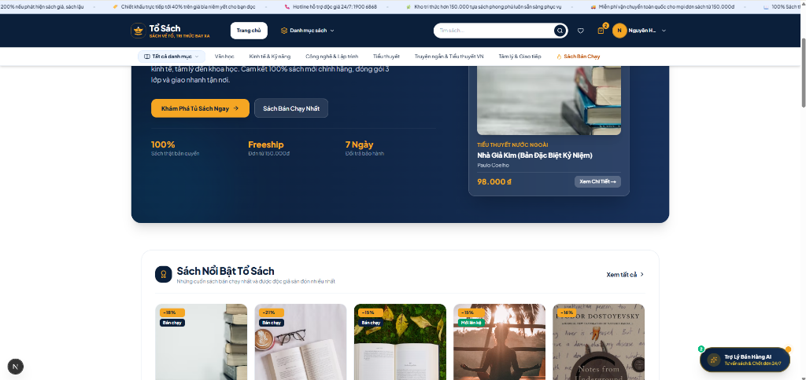
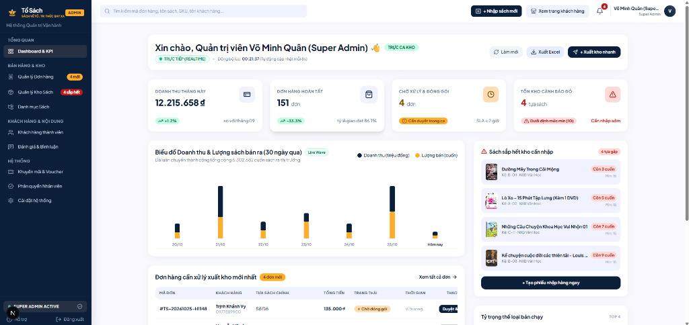
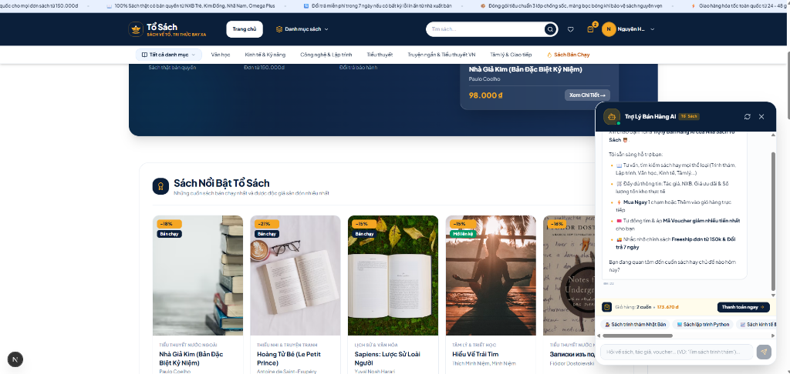
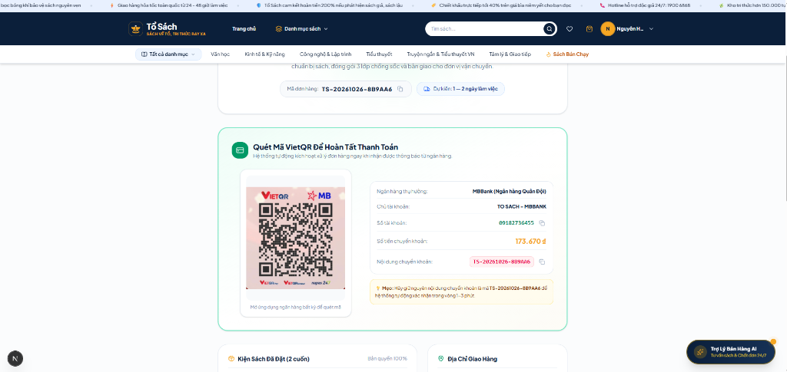

# 📚 Tổ Sách — Nền Tảng Thương Mại Điện Tử Sách Trực Tuyến (B2C)

> **Nền tảng thương mại điện tử chuyên sâu ngành sách (B2C), sở hữu kiến trúc giao dịch ACID toàn vẹn, phân quyền 4 vai trò độc lập, tích hợp thanh toán VietQR tự động và Trợ lý bán hàng Agentic AI.**

[](https://nextjs.org/)
[](https://www.typescriptlang.org/)
[](https://www.prisma.io/)
[](https://supabase.com/)
[](https://tailwindcss.com/)
[](https://ai.google.dev/)

---

### 🖼️ Giao diện Nền tảng & Điểm Nhấn Công Nghệ (Showcase)

| 🌐 Cửa hàng Khách hàng (Storefront B2C) | ⚙️ Dashboard Quản trị & Phân quyền (Admin) |
| :---: | :---: |
|  |  |
| *Giao diện mua sắm B2C, danh mục đa chiều, Zero CLS* | *Báo cáo doanh thu thời gian thực, ẩn số liệu với Staff* |
| 🤖 **Trợ lý Bán Hàng Agentic AI (Gemini ReAct)** | 💳 **Thanh Toán VietQR MBBank Tự Động** |
|  |  |
| *Chatbot tư vấn sách, ReAct Tool Calling 5 công cụ* | *Tự sinh mã QR Napas đúng số tiền và nội dung chuyển khoản* |

---

## 👥 Thành Viên & Vai Trò (Project Team & Roles)

Dự án được thực hiện bởi nhóm 2 thành viên:

* **Nguyễn Đăng Hanh ([@Hanh-Dang](https://github.com/Hanh-Dang)) — Ý tưởng & Thiết kế hệ thống (System Design), Backend**  
  * Đề xuất ý tưởng và định hướng dự án.
  * Thiết kế kiến trúc hệ thống và cơ sở dữ liệu quan hệ PostgreSQL chuẩn 3NF.
  * Xây dựng các nghiệp vụ phía máy chủ (Server Actions, API Route Handlers), luồng giao dịch ACID.
  * Thiết lập cơ chế xác thực an toàn (JWT, HttpOnly cookie, Bcrypt) – phân quyền đa vai trò (RBAC) và tích hợp Trợ lý bán hàng Agentic AI.

* **Nguyễn Mạnh Hòa ([@ManhHoa2405](https://github.com/ManhHoa2405)) — Frontend & Thiết kế giao diện**  
  * Thiết kế giao diện và bộ nhận diện thương hiệu trên Figma (Palette `#0B1F3A` & `#F5A623`, Typography Plus Jakarta Sans).
  * Xây dựng giao diện cửa hàng (Storefront B2C) và trang quản trị (Admin Portal) theo thiết kế hệ thống đã thống nhất.
  * Lập trình trải nghiệm người dùng, vi tương tác chuyển động 60fps và quy trình thanh toán VietQR động.

> 🤝 **Quy trình phối hợp:** Hanh đưa ra ý tưởng và thiết kế hệ thống, thống nhất với Hòa, sau đó Hòa triển khai phần giao diện tương ứng.

---

## ⚡ Điểm Nhấn Kỹ Thuật (Key Engineering Highlights)

1. **Giao dịch Đặt hàng Nguyên tử (ACID Transactions with Prisma)**  
   * Toàn bộ quy trình checkout từ: *Kiểm tra tồn kho $\to$ Khóa trừ tồn kho $\to$ Khóa kiểm tra hạn mức sử dụng Voucher $\to$ Tạo Order & OrderItems $\to$ Ghi nhận lịch sử dùng mã* đều được đóng gói trong một `prisma.$transaction`. 
   * Nếu có bất kỳ bước nào thất bại, hệ thống tự động Rollback 100%, triệt tiêu hoàn toàn rủi ro bán vượt tồn kho (over-selling) khi có lượng truy cập đồng thời.

2. **Phân quyền Đa cấp độ (RBAC via Edge Proxy / Middleware)**  
   * Bảo vệ các route `/admin/*` ở tầng Edge trước khi chạm vào Server Components.
   * Quản lý ma trận 4 vai trò: `Khách vãng lai`, `Khách hàng`, `Nhân viên Đơn / Kho`, `Super Admin`.
   * **Bảo mật tài chính:** Nhân viên nghiệp vụ (Staff) bị ẩn hoàn toàn các thẻ doanh thu cả ở tầng hiển thị DOM lẫn tầng API (`/api/admin/dashboard/realtime` chặn trả về số liệu).

3. **Cơ chế Gộp giỏ hàng Thông minh (Smart Cart Merge)**  
   * Khách vãng lai thao tác mượt mà trên trình duyệt qua LocalStorage. 
   * Khi thực hiện đăng nhập hoặc đăng ký tài khoản mới, hệ thống tự động đối soát, kiểm tra tồn kho và gộp giỏ hàng cục bộ vào giỏ hàng tài khoản trên máy chủ mà không làm gián đoạn trải nghiệm mua sắm.

4. **Trợ lý Bán hàng Agentic AI (Gemini ReAct Tool Calling Loop)**  
   * Tích hợp Google Gemini 3.1 Flash-Lite chạy vòng lặp ReAct độc lập với 5 tools chuyên biệt (`search_books`, `recommend_best_voucher`, `apply_voucher`, `get_book`, `list_active_events`).
   * Chatbot tự động truy vấn CSDL qua thuật toán unaccent ILIKE scoring, tự chọn voucher tối ưu cho đơn hàng và kết xuất giao diện thẻ sách Block-Sequential kèm nút Mua ngay 1-Click.

5. **Thiết kế Cơ sở Dữ liệu 17 Bảng Chuẩn 3NF & Địa giới Hành chính 3 Cấp**  
   * Chuẩn hóa toàn bộ quan hệ sách đa tác giả, danh mục phân cấp đa tầng, lưu trữ địa chỉ nhận hàng theo chuẩn 3 cấp hành chính Việt Nam (Tỉnh/Thành $\to$ Quận/Huyện $\to$ Phường/Xã).
   * Tích hợp thanh toán VietQR động chuẩn Napas MBBank (tự sinh mã QR đúng số tiền và nội dung chuyển khoản).

---

## 🛠️ Công Nghệ Lõi (Tech Stack)

* **Tầng Trình diễn (Frontend):** Next.js 16 (App Router, React 19, Server Components), Tailwind CSS v4, Plus Jakarta Sans, Lucide Icons, Framer Motion.
* **Tầng Dịch vụ & Nghiệp vụ (Backend):** Next.js API Routes, Server Actions, Edge Proxy Middleware.
* **Tầng Dữ liệu & Lưu trữ (Database):** PostgreSQL (Supabase Cloud / Neon), Prisma 6 ORM (17 bảng quan hệ chuẩn 3NF).
* **Bảo mật & Tối ưu (Security & Performance):** Custom JWT (HS256 với thư viện `jose`), HttpOnly Cookies chống XSS/CSRF, Bcrypt hashing, Rate Limiting (Upstash Redis / In-memory fallback chống brute-force).
* **Trí tuệ nhân tạo & Tìm kiếm (AI & Search):** Google Gemini 3.1 Flash-Lite API (ReAct 5 tools), PostgreSQL unaccent ILIKE scoring & tùy chọn tích hợp Elasticsearch 8.x.

---

## 🔑 Tài Khoản Thử Nghiệm Mặc Định (Seed Test Accounts)

| Vai trò | Tài khoản Đăng nhập | Mật khẩu | Đặc quyền hệ thống kiểm thử |
| :--- | :--- | :--- | :--- |
| **Super Admin** | `admin@tosach.vn` | `Admin@123` | Toàn quyền hệ thống: xem doanh thu thời gian thực, quản lý kho, duyệt đơn, tạo voucher, quản trị nhân sự & phân quyền. |
| **Nhân viên Kho** | `staff.kho@tosach.vn` | `Staff@123` | Quản lý kho sách & cây danh mục, nhập kho hàng loạt CSV. *(Bị ẩn hoàn toàn doanh thu shop)*. |
| **Nhân viên Đơn** | `staff.order@tosach.vn` | `Staff@123` | Xử lý vòng đời đơn hàng (State Machine), kiểm duyệt đánh giá, xem voucher. *(Bị ẩn hoàn toàn doanh thu shop)*. |
| **Khách hàng** | `customer@gmail.com` | `User@123` | Tìm kiếm, thêm giỏ, áp mã voucher, thanh toán VietQR động và tra cứu hành trình đơn hàng. |

> ⚠️ **Lưu ý:** Các tài khoản trên chỉ phục vụ cho môi trường kiểm thử / demo cục bộ. Tuyệt đối không dùng lại các mật khẩu này khi triển khai môi trường Production thực tế.

---

## 🚀 Khởi Chạy Local Nhanh (Quickstart Guide)

### 1. Chuẩn bị môi trường
* **Node.js**: `>= 20.x LTS` (kiểm tra bằng lệnh: `node -v`)
* **PostgreSQL**: Cơ sở dữ liệu đám mây (khuyến nghị dùng [Supabase](https://supabase.com)) hoặc PostgreSQL Local.

### 2. Cài đặt & Cấu hình biến môi trường
```bash
# 1. Tải mã nguồn về máy
git clone https://github.com/Hanh-Dang/DALN-CNTT-1-1-26-N02_To-Sach.git
cd DALN-CNTT-1-1-26-N02_To-Sach

# 2. Cài đặt các thư viện phụ thuộc
npm install

# 3. Tạo file cấu hình môi trường (.env)
cp .env.example .env
```
*Mở file `.env` và điền chuỗi kết nối PostgreSQL (`DATABASE_URL`, `DIRECT_URL`), mã bảo mật `JWT_SECRET` và API key `GEMINI_API_KEY`.*

### 3. Đồng bộ CSDL & Nạp Dữ Liệu Hạt Giống
```bash
# Đẩy schema lên database và sinh Prisma Client
npx prisma db push
npx prisma generate

# Nạp dữ liệu hạt giống ban đầu (tài khoản test, phân quyền, danh mục, sách, voucher, sự kiện)
npx prisma db seed
```

> **Tùy chọn mở rộng (Large Dataset):** Để nạp kho sách 5.000+ cuốn và lịch sử đánh giá thực tế:  
> `npx tsx prisma/seed-large-dataset.ts` && `npx tsx prisma/seed-reviews.ts`

### 4. Khởi động Máy chủ Phát triển
```bash
npm run dev
```
* Mở trình duyệt web và truy cập: 👉 **`http://localhost:3000`**
* Mở giao diện xem và quản trị cơ sở dữ liệu trực quan: `npx prisma studio` (truy cập tại: `http://localhost:5555`).

---

## 📚 Tài Liệu Kỹ Thuật Chuyên Sâu

Để xem chi tiết tài liệu phân tích hệ thống toàn diện, sơ đồ kiến trúc N-tier, sơ đồ tuần tự (Sequence Diagram), sơ đồ luồng dữ liệu (DFD Mức 0, 1, 2) và từ điển dữ liệu 17 bảng:  
👉 Vui lòng tham khảo file: [**`Document_Project.md`**](./Document_Project.md)

---
*Dự án thực hiện trong khuôn khổ Đồ Án Liên Ngành CNTT (10/2026) — Nhóm tác giả Nguyễn Đăng Hanh & Nguyễn Mạnh Hòa.*
